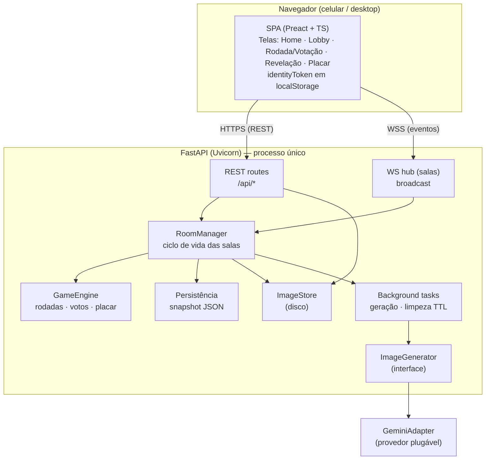
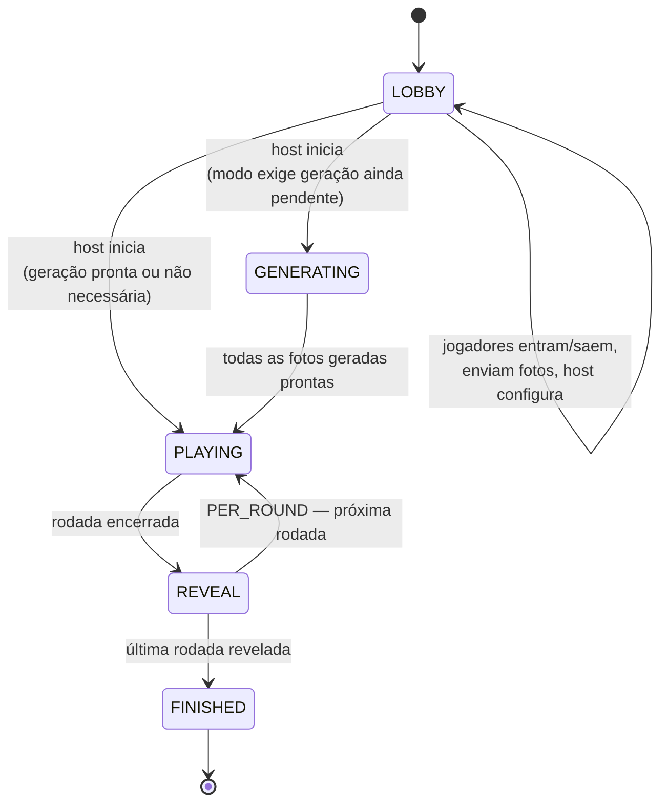

# Design — "Quem Sou Eu?" (Jogo do Dia das Crianças)

## 1. Abordagem geral

Aplicação web de uma única sala-por-partida, tempo real, sem contas. Backend em
**Python (FastAPI)** servindo uma API HTTP + um canal **WebSocket** por sala; o
frontend é uma **SPA leve** (Vite + Preact/TypeScript) servida pelo próprio
backend. O estado da partida vive em memória no processo (fonte da verdade),
com persistência leve para sobreviver a reinícios curtos. A geração de imagem é
abstraída atrás de uma interface `ImageGenerator`, com um adapter Gemini como
primeiro provedor.

Decisões travadas (ver `.spec-state.json`):
- Pontuação: **1 ponto por acerto**.
- Encerramento da votação: **automático quando todos votam, com o host podendo
  forçar**.
- API de imagem: **interface plugável**, provedor default = Gemini.

Princípios (dev solo, OSS/self-host, Python): poucas peças, dependências
mínimas, nada de serviço pago além da API de imagem, tudo roda num único
processo + um disco local.

## 2. Arquitetura



### Por que estado em memória
Uma partida é curta (minutos), de 3–12 pessoas, e termina. Estado em memória dá
tempo real trivial e simples de raciocinar. Para não perder tudo num reinício,
cada mudança relevante dispara um **snapshot** assíncrono em JSON no disco
(`data/rooms/<code>.json`); ao subir, o processo recarrega salas não expiradas.
Isso evita um banco relacional sem abrir mão de resiliência básica — coerente
com o perfil dev-solo. (Escala para múltiplos processos é fora de escopo.)

## 3. Stack

- **Backend:** Python 3.12, FastAPI, Uvicorn, Pydantic v2. WebSocket nativo do
  Starlette. `httpx` para chamar a API de imagem. `Pillow` para validar/normalizar
  imagens (reorientar EXIF, reencodar, limitar dimensão).
- **Frontend:** Vite + Preact + TypeScript, roteamento leve, CSS simples
  (mobile-first). Build estático servido pelo FastAPI em produção.
- **Armazenamento:** disco local (`./data`): imagens em `data/images/<room>/`,
  snapshots em `data/rooms/<code>.json`. Sem DB externo.
- **Config:** variáveis de ambiente (`.env`): `IMAGE_PROVIDER`, chave da API,
  `ROOM_TTL_HOURS`, `MAX_UPLOAD_MB`, etc.
- **Testes:** pytest (regras do GameEngine como alvo principal — lógica pura).

## 4. Modelo de domínio

Entidades (Pydantic/dataclasses em memória; serializadas no snapshot):

```python
Room:
  code: str                 # 6 chars, único
  phase: Phase              # LOBBY | GENERATING | PLAYING | REVEAL | FINISHED
  host_id: str              # == player.id do host
  config: RoomConfig
  players: dict[str, Player]
  rounds: list[Round]       # montadas no start
  current_round_idx: int
  created_at, updated_at: datetime

RoomConfig:
  display_mode: DisplayMode # CHILD_ONLY | GENERATED_ONLY | BOTH | SEQ_CHILD_FIRST | SEQ_GENERATED_FIRST | RANDOM
  reveal_mode: RevealMode   # END_OF_GAME | PER_ROUND
  targets_per_round: int    # 1..3
  max_players: int          # <=12

Player:
  id: str                   # == identityToken (uuid4), nunca exposto a outros
  nickname: str
  is_host: bool
  child_photo: PhotoRef | None
  generated_photo: PhotoRef | None
  gen_status: GenStatus     # NONE | PENDING | GENERATING | READY | FAILED
  score: int
  connected: bool

PhotoRef:
  id: str                   # nome de arquivo opaco
  mime: str

Round:
  index: int
  targets: list[str]        # player_ids (1..3)
  display_per_target: dict[str, DisplayMode]  # modo efetivo (resolve RANDOM)
  seq_stage: dict[str, int] # p/ modos sequenciais: 0 = primeira imagem, 1 = segunda
  votes: dict[str, dict[str, str]]  # target_id -> {voter_id -> guessed_player_id}
  status: RoundStatus       # VOTING | CLOSED | REVEALED
```

### IDs e identidade
- O `identityToken` é um uuid4 gerado no cliente no primeiro acesso, guardado em
  `localStorage`, e enviado em todo request/WS. É a identidade do jogador dentro
  da sala. Nunca é enviado a outros clientes (ver §8, projeção por destinatário).
- O código da sala usa alfabeto sem ambíguos: `ABCDEFGHJKLMNPQRSTUVWXYZ23456789`.

## 5. Máquina de estados da sala



- **GENERATING** só ocorre se `display_mode` exigir foto gerada e ainda houver
  geração pendente ao iniciar; caso todas já estejam prontas, pula direto para
  PLAYING. (A geração começa de forma oportunista já no LOBBY — ver §7.)
- Em **PER_ROUND**: após cada rodada vai a REVEAL daquela rodada e volta a
  PLAYING na próxima; após a última rodada vai a FINISHED.
- Em **END_OF_GAME**: joga todas as rodadas (PLAYING), depois um REVEAL único
  rodada-a-rodada, depois FINISHED.

Transições são sempre feitas no servidor pelo `GameEngine`; o cliente só
solicita (ex.: "iniciar", "forçar encerramento", "avançar imagem", "próxima
rodada"), e o servidor valida permissão (só host) e pré-condições.

## 6. Montagem das rodadas (start do jogo)

Entrada: lista de jogadores `P` (todos com foto; se o modo exige, geradas
prontas), `targets_per_round = k`.

1. Embaralhar `P` com `random.shuffle` (ordem imprevisível — RF-6.3).
2. Particionar a lista embaralhada em grupos de tamanho `k`. O último grupo pode
   ter 1..k alvos (resto). Cada grupo vira uma `Round`.
3. Para cada alvo de cada rodada, resolver o `display_mode` efetivo:
   - modos fixos (CHILD_ONLY, GENERATED_ONLY, BOTH, SEQ_*) → copia o modo.
   - RANDOM → sorteia por alvo entre {CHILD_ONLY, GENERATED_ONLY, BOTH}
     (sequencial não entra no sorteio para manter o fluxo simples).
4. `current_round_idx = 0`, `phase = PLAYING`.

Exemplo: 7 jogadores, k=3 → rodadas de [3,3,1]. k=1 → 7 rodadas de 1.

## 7. Geração de imagem (assíncrona e plugável)

Interface:
```python
class ImageGenerator(Protocol):
    async def generate_adult(self, child_image: bytes, mime: str) -> GeneratedImage: ...
    # GeneratedImage: bytes + mime; levanta ImageGenError em falha
```

- Adapter default `GeminiAdapter` (chama o endpoint de geração/edição de imagem
  via `httpx`, com o prompt pedindo uma versão realista adulta/atual da mesma
  pessoa, preservando traços; sem exagerar envelhecimento). O provedor é
  selecionado por `IMAGE_PROVIDER` e injetado no `RoomManager`.
- **Disparo:** assim que um jogador confirma a foto E a config atual exige foto
  gerada, uma background task chama o generator. Resultado atualiza
  `generated_photo` + `gen_status=READY` e emite evento `player_updated`.
  Debounce: se o host trocar o modo para um que não exige geração, não cancela o
  que já começou, mas não dispara novas.
- **Falha/timeout:** `gen_status=FAILED`, evento com motivo legível; botão de
  retry (jogador ou host). Timeout por chamada (ex. 60 s) via `httpx`.
- **Custo (RNF-4):** nunca gera sem necessidade; só uma geração por foto; retry
  é explícito. Prompt e parâmetros centralizados num só lugar.

Fallback de resiliência (RNF-3): se a API estiver fora e o modo exigir geração,
o host vê um aviso e pode trocar para `CHILD_ONLY` para jogar mesmo assim.

## 8. API

### REST (JSON) — ações pontuais
Todas (exceto criar sala) exigem header `X-Identity: <token>` e, quando
aplicável, pertencer à sala.

- `POST /api/rooms` — cria sala. Body: `{nickname, config}`. Retorna
  `{code, identityToken, room}`.
- `POST /api/rooms/{code}/join` — entra. Body: `{nickname}`. Erros: 404 (não
  existe), 409 (apelido em uso), 423 (jogo já começou), 403 (lotada).
- `PATCH /api/rooms/{code}/config` — host atualiza config (só em LOBBY).
- `POST /api/rooms/{code}/photo` — multipart: upload da foto de criança.
  Valida mime/tamanho (`MAX_UPLOAD_MB`), normaliza com Pillow, salva, associa ao
  jogador. Dispara geração se o modo exigir.
- `POST /api/rooms/{code}/photo/regen` — força nova geração (jogador dono da
  foto ou host).
- `GET /api/rooms/{code}/images/{imageId}` — serve a imagem. **Só** se o
  solicitante pertence à sala E a imagem já pode ser vista por ele (regra de
  privacidade, ver abaixo). Sem cache público; `Cache-Control: private`.
- `POST /api/rooms/{code}/start` — host inicia (valida pré-condições).
- `POST /api/rooms/{code}/close` — host encerra a sala (limpeza imediata).

### WebSocket — `GET /ws/rooms/{code}?token=...`
Canal bidirecional por sala.

Mensagens do cliente → servidor:
- `{type:"vote", target_id, guess_player_id}` — registra/altera voto (só em
  VOTING; não permitido votar em si mesmo como alvo).
- `{type:"advance_image", target_id}` — host avança a 2ª imagem (modos SEQ_*).
- `{type:"force_close_round"}` — host força encerramento da votação.
- `{type:"next"}` — host avança rodada / revelação / finaliza.
- `{type:"ping"}` — keepalive.

Mensagens servidor → cliente (broadcast ou dirigidas):
- `room_state` — estado completo projetado para o destinatário (ao conectar e
  após mudanças de fase).
- `player_joined` / `player_left` / `player_updated` (status de foto/geração).
- `config_updated`.
- `round_started` (inclui o que mostrar), `vote_progress` ("X de N"),
  `image_advanced`.
- `round_revealed` / `game_revealed` (identidades + mapa de votos + placar).
- `error` (`{code, message}`).

### Projeção por destinatário (privacidade — RNF-1 / RF-4.5 / RF-7.7)
O servidor nunca envia dados que o destinatário não pode ver:
- No LOBBY, nenhum cliente recebe URLs de fotos de outros jogadores (só o flag
  "foto enviada" / status de geração).
- Durante VOTING, cada cliente recebe apenas as imagens do(s) alvo(s) atual(is)
  no estágio permitido pelo `display_mode`; votos individuais ficam ocultos
  (só o agregado `vote_progress`).
- Só em REVEAL o servidor envia identidade real do alvo + o mapa completo de
  votos. A autorização de `GET .../images/{id}` segue a mesma regra: uma imagem
  de alvo só é servível a quem está naquela sala e cujo estado de jogo já libera
  aquela imagem.

## 9. Regras de votação e pontuação (GameEngine)

- Em VOTING, para cada `target_id` da rodada, cada jogador que **não é aquele
  alvo** registra exatamente um palpite (`guess_player_id`), alterável até o
  fechamento. O alvo não vota sobre si mesmo (RF-7.8); se a rodada agrupa vários
  alvos, ele vota nos outros.
- **Encerramento automático:** a rodada fecha quando, para todos os alvos da
  rodada, todos os votantes elegíveis já votaram. O host pode `force_close_round`
  antes disso (votos faltantes contam como não-voto / errado).
- `vote_progress` por rodada = votantes que completaram todos os alvos / total
  de votantes elegíveis.
- **Pontuação:** na revelação, para cada alvo, cada votante com
  `guess_player_id == target_id` ganha **+1**. (Independente por alvo; numa
  rodada agrupada dá para somar até `targets_per_round` pontos.)
- **Placar final:** jogadores ordenados por `score` desc; empates compartilham
  posição; vencedor(es) destacados (RF-8.3).

## 10. Ciclo de vida, limpeza e persistência (RF-10)

- Cada sala tem `updated_at`. Uma background task periódica (ex. a cada 10 min)
  remove salas com inatividade > `ROOM_TTL_HOURS` (default 24): apaga o snapshot
  e o diretório de imagens da sala. `POST .../close` faz o mesmo imediatamente.
- Snapshot: a cada mutação relevante, grava `data/rooms/<code>.json` (debounced).
  No start do processo, recarrega salas não expiradas (imagens continuam no
  disco referenciadas por `PhotoRef.id`).
- Acessar sala inexistente/expirada → tela "sala encerrada" (RF-10.2).

## 10b. Direção visual (tema fliperama 8-bit / pixel art)

**Conceito:** "fliperama retrô" — a interface imita um videogame 8-bit de
arcade/console da era 80/90: fonte bitmap pixelada, paleta limitada de cores
saturadas tipo NES, bordas em pixel (sem antialias), sombras duras, HUD de jogo
("PLAYER 1", "SCORE", "ROUND 1-3") e microanimações em sprite. Combina com Dia
das Crianças pela vibe lúdica de videogame antigo e dá um enquadramento divertido
para as fotos (molduras em pixel estilo "cartucho/TV CRT").

### Paleta (tokens CSS — paleta limitada estilo NES)
```css
:root {
  --bg:          #0f0f23;  /* fundo escuro de tela CRT */
  --bg-panel:    #1a1a40;  /* painéis/HUD */
  --fg:          #e8e8f0;  /* texto claro (pixel) */
  --fg-soft:     #9a9ac0;  /* texto secundário */
  --accent:      #ff3b3b;  /* vermelho arcade (CTA, PLAYER 1) */
  --accent-2:    #35c7ff;  /* ciano neon (secundário) */
  --accent-3:    #ffd23f;  /* amarelo moeda (destaques) */
  --ok:          #3bff6a;  /* verde "START"/acerto */
  --gold:        #ffcf3f;  /* 1º lugar */
  --silver:      #c5c5d6;  /* 2º lugar */
  --bronze:      #c97b3f;  /* 3º lugar */
  --outline:     #000000;  /* contorno em pixel */
  --scanline:    rgba(0,0,0,0.18); /* overlay CRT scanlines */
}
```
A SPA usa **estes tokens**, nunca cores soltas. Sempre definir fundo + cor de
texto juntos (legibilidade em tema escuro).

### Tipografia
- **Fonte única bitmap:** uma pixel font (ex.: *Press Start 2P*) para títulos e
  HUD; para blocos de texto corrido maiores, uma pixel font de leitura mais
  confortável (ex.: *Silkscreen* / *VT323*) para não cansar no celular.
- Carregada **localmente** (self-host, sem CDN de terceiros — privacidade).
- `font-smooth: never` / sem antialias onde a fonte for bitmap; tamanhos em
  múltiplos inteiros para manter os pixels nítidos.

### Elementos visuais
- **`image-rendering: pixelated`** em todo asset/escala de sprite (nitidez de
  pixel, sem borrão).
- **Fotos emolduradas estilo cartucho/TV:** cada foto (criança/gerada) dentro de
  uma moldura em pixel com borda dupla (contorno preto + cor), cantos "chanfrados"
  em pixel; opcional overlay leve de **scanlines CRT**. As fotos reais dos
  jogadores NÃO são pixelizadas (manteriam o reconhecimento difícil) — só a
  moldura/HUD é pixel art; a foto fica nítida dentro do "monitor".
- **HUD de jogo:** topo com rótulos arcade — "ROUND 1-3", "SCORE", contador de
  votos como "VOTES 4/6". Barras e caixas desenhadas com bordas de 2–4 px.
- **Botões:** estilo "botão de arcade" — bloco com borda dura e sombra de pixel
  (offset sólido), efeito de "afundar" ao pressionar; disabled esmaecido.
- **Placar:** tela "HIGH SCORE" com ranking monoespaçado, medalhas em pixel
  (ouro/prata/bronze) e piscar do 1º lugar.
- **Ícones:** sprites 1-bit/poucas cores, grade 16×16 ou 24×24.

### Movimento / microinterações
- Revelação do alvo: efeito "power-up" — a moldura pisca e o nome aparece com
  um pequeno "pop" em sprite. Entrada de jogador: "INSERT COIN"/"PLAYER JOINED".
- Transição de rodada estilo "LEVEL START". Animações curtas (<300 ms),
  passo-a-passo (sem easing suave demais, para parecer frame-based) e
  respeitando `prefers-reduced-motion` (desliga piscar/scanlines).

### Acessibilidade do tema
- Contraste AA entre `--fg` e `--bg`/`--bg-panel` (paleta escolhida já cumpre).
- Nunca depender só de cor para estado (votou = cor + ícone + texto "OK").
- Área de toque ≥ 44 px apesar do visual "retrô pequeno" (os elementos de pixel
  são ampliados em múltiplos inteiros, mas o alvo de toque é generoso).
- `prefers-reduced-motion` desativa scanlines, piscar e flips.

### Entrega
- Tokens e tema num único `theme.css` (variáveis + utilitários de borda/sombra
  em pixel + overlay de scanlines) e componentes Preact: `PixelFrame` (moldura
  da foto/monitor), `PixelPanel`, `ArcadeButton`, `Hud`, `Scoreboard`. As tasks
  de UI referenciam estes componentes. Sprites/ícones como SVG ou PNG em grade
  pequena, servidos localmente.

### Impacto na stack (revisão)
Pixel art 8-bit é **puramente de apresentação** (CSS + fontes bitmap +
`image-rendering: pixelated` + sprites estáticos). **Não exige nenhuma mudança
no backend, no modelo de domínio, na API, no tempo real ou na geração de
imagem.** A stack escolhida (FastAPI + WebSocket + SPA Preact/TS + Vite)
continua adequada:
- As fontes bitmap e sprites são assets estáticos no bundle Vite — zero
  dependência nova de servidor.
- Vite serve/otimiza assets normalmente; `image-rendering: pixelated` é CSS.
- Nenhuma biblioteca de jogo (Phaser/canvas game loop) é necessária: o jogo é
  baseado em DOM/eventos, não em renderização por frame; o "pixel" é só estilo.
- Único acréscimo: incluir as fontes bitmap e um punhado de sprites no repo
  (self-host) e os componentes de tema citados acima.

Conclusão: **a stack permanece a mesma**; a mudança de tema afeta apenas a
camada de UI (§10b, §11 e as tasks de frontend).

## 11. Frontend (telas e fluxo)

- **Home:** criar sala (apelido) ou entrar (código + apelido). Lê/gera
  `identityToken`.
- **Lobby:** lista de participantes com status (foto enviada / geração), botão
  de upload com preview, painel de config (só host) com resumo das regras em
  tempo real, botão "Iniciar" (habilita quando pré-condições OK).
- **Rodada/Votação:** mostra a(s) foto(s) do(s) alvo(s) conforme o modo; grade
  de nomes para votar (um voto por alvo; próprio nome bloqueado para o alvo que
  é você); indicador "X de N votaram"; controles do host (avançar imagem /
  forçar encerramento / próxima).
- **Revelação:** identidade, foto criança + gerada, quem votou em quem; placar
  parcial (PER_ROUND) ou sequência de revelações (END_OF_GAME).
- **Placar final:** ranking, vencedores, "jogar de novo" (nova sala reusando
  participantes/fotos — RF-8.5).

Mobile-first: upload aceita câmera/galeria; layout em coluna; imagens com
proporção fixa e lazy.

## 12. Segurança e privacidade

- Sem login; identidade por token opaco por navegador. Token nunca exposto a
  terceiros.
- Imagens servidas só a membros da sala e só quando o estado libera; `Cache-
  Control: private`, `X-Robots-Tag: noindex`.
- Upload: limite de tamanho, allowlist de MIME, reencode com Pillow (remove
  metadados/EXIF sensíveis), limite de dimensão.
- Rate limiting simples por IP/token em criar sala e upload para evitar abuso.
- Dados apagados no fim da vida da sala (sem retenção — RF-10.3).

## 13. Mapeamento Requisitos → Design

| Requisito | Onde é atendido |
|-----------|-----------------|
| RF-1 Criar sala | §8 `POST /api/rooms`, §4 código sem ambíguos, identityToken |
| RF-2 Entrar | §8 `join` (erros 404/409/423/403), §5 só em LOBBY |
| RF-3 Configurar | §4 RoomConfig, §8 `PATCH config`, §6 modos, §5 trava fora do lobby |
| RF-4 Foto criança | §8 `photo` upload+Pillow, §8 projeção (não revela) |
| RF-5 Geração | §7 interface + Gemini, assíncrono, retry, status |
| RF-6 Iniciar | §8 `start`, §6 montagem+shuffle, pré-condições |
| RF-7 Rodada/voto | §8 WS vote/advance/force, §9 regras, §8 projeção |
| RF-8 Revelação/placar | §9 pontuação, §5 reveal modes, §11 placar/jogar de novo |
| RF-9 Tempo real | §2 WS hub, §8 room_state na reconexão |
| RF-10 Ciclo de vida | §10 TTL, close, snapshots |
| RNF-1..8 | §12 privacidade, §7 resiliência/custo, §3 stack enxuta, §11 mobile |

## 14. Riscos e mitigação

- **Qualidade/latência da geração:** mitigado por geração oportunista no lobby,
  status visível, retry e fallback para modo sem geração.
- **Perda de estado em reinício:** mitigado por snapshots + reload; perda máxima
  é a última mutação não gravada (debounce curto).
- **Conteúdo sensível (fotos de criança):** projeção por destinatário,
  autorização nas imagens, apagamento no fim da sala, sem indexação.
- **Multi-processo/escala:** explicitamente fora de escopo; se precisar, trocar
  estado em memória por Redis + pub/sub é a evolução natural (a interface do
  RoomManager já isola isso).

## 15. Fora de escopo do design

- Banco relacional, filas externas, múltiplos processos/instâncias.
- Autenticação federada / contas.
- CDN para imagens (servidas pelo app, com autorização).
